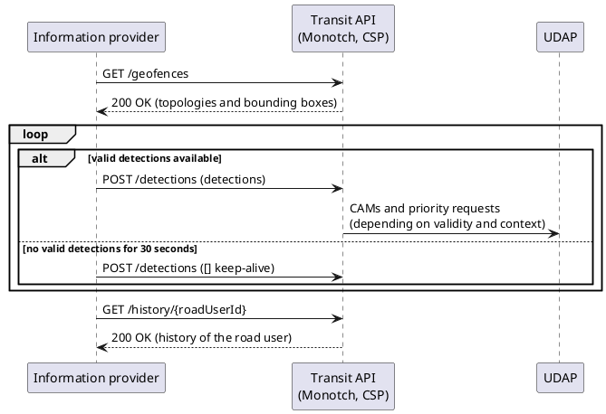

# Introduction

This document describes the Transit API: the REST endpoints that information providers use to deliver road user detections to Monotch.

Monotch acts as ITS Cloud Service Provider (CSP). The Transit API validates the received detections and, depending on their validity and context, publishes messages to UDAP, such as Cooperative Awareness Messages (CAMs) and priority requests for traffic light controllers.

The [Urban Data Access Platform (UDAP)](https://monotch.com/implementation/udap/) is the national platform in the Netherlands that connects actors in the smart mobility ecosystem. It enables bi-directional, continuous and real-time data exchange, is vendor-independent, and keeps control with the local (city and road) authorities.

The API offers three endpoints:

- **Geofences** - Retrieve the list of topologies and their bounding boxes, so that an information provider can determine whether its detection data is relevant to a specific topology
- **Detections** - Deliver detection data (location, speed, heading and route) of road users
- **History** - Retrieve the processing history of a road user: accepted detections, passages, and the priority requests and CAMs published to UDAP

## Target group

This document is intended for information providers, such as bike fleet operators and cycling app providers, wanting to share the detections of their cyclists through the Transit API. It is the technical specification for the connection between their systems and the Transit API.

## Interface flow

1. **Retrieve geofences** - Retrieve the topologies and their bounding boxes using `GET /geofences`
2. **Select relevant detections** - Use the bounding boxes to determine which detections are relevant to a topology
3. **Post detections** - Send the relevant detections using `POST /detections`
4. **Keep alive** - Send an empty array to `POST /detections` every 30 seconds when there are no valid detections to post
5. **Check history** - Optionally retrieve the history of a road user using `GET /history/{roadUserId}` to see how its detections were processed

See [REST API](rest-api.md) for the details of each endpoint.

## Versioning

This document uses a versioning scheme that indicates the version of the API specification and tracks the revisions of this document. The scheme is `<specification version major>.<specification version minor>.<document revision>`.

- The **major** version is only bumped when there is a compatibility-breaking change in the specification
- The **minor** version is bumped on trivial, non-breaking changes of the specification
- The **document revision** is bumped on changes to this document that do not change the specification

The current document version is shown in the footer of every page.

### Version history

| Version | Date | Changes |
|---|---|---|
| 1.1.0 | 2026-11-24 | History endpoint added |
| 1.0.0 | 2025-08-04 | Intersection reference points included in the geofences response; speed changed from an Integer to a Double |
| 0.1.1 | 2025-07-10 | Detection speed and heading are made nullable; detection payload size limit enforced |
| 0.1.0 | 2025-01-29 | Initial release |

## Abbreviations

| Abbreviation | Description |
|---|---|
| API | Application Programming Interface |
| CAM | Cooperative Awareness Message |
| CSP | (ITS) Cloud Service Provider |
| HTTPS | Hypertext Transfer Protocol Secure |
| ISO 8601 | International standard for date and time representation |
| ITS | Intelligent Transport Systems |
| JSON | JavaScript Object Notation |
| REST | Representational State Transfer |
| SRM | Signal Request Message (priority request) |
| TLC | Traffic Light Controller |
| UDAP | Urban Data Access Platform |

## References

- [Urban Data Access Platform (UDAP)](https://monotch.com/implementation/udap/)
- [ISO 8601 date and time format](https://www.iso.org/iso-8601-date-and-time-format.html)
- [JSON standards](https://www.json.org)
- [RFC 7617 - The 'Basic' HTTP Authentication Scheme](https://datatracker.ietf.org/doc/html/rfc7617)
